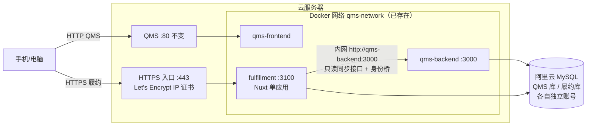

# 项目履约系统：技术选型与第一期（MVP）范围（v0.3）

> **版本**：v0.1（2026-10-16）→ **v0.2（2026-10-16，并入 zhao 回答：仓库名由 Claude 定；生产 MySQL 在阿里云；不用域名，直接用 IP；角色暂定 5 个；试点工单待定）** → **v0.3（里程碑改为先本地开发验收，R6 再上生产）**
> **输入**：[系统方案设计.md](系统方案设计.md)（v0.4，下称"方案"）。模块 M1–M6、规则 W1–W4、约束 T1–T10 均指方案中的编号。
> **用途**：第 4 步（搭建 MVP）的开工依据：用什么技术、怎么部署、QMS 要补什么、第一期做哪些页面、怎样算做完、按什么顺序做。
>
> **标注说明**：【已确认】= zhao 已确认，或代码核查确实存在；【推荐】= 本文的选型结论；【待确认】= 开工前需要 zhao 提供或决定的信息，见第 10 节。

---

## 0. 结论摘要

1. **技术栈与 QMS 保持一致，但结构大幅简化**：Nuxt 3（Vue 3 + 内置 Nitro 服务端）一个应用，Prisma + MySQL，TypeScript。电脑端用 Ant Design Vue，手机端 4 个页面用 Vant。zhao 熟悉这套技术，QMS 的经验可直接复用；但不搬 QMS 的 monorepo、turbo、changeset 和各类治理检查。
2. **部署在 QMS 同一台云服务器上**：用 Docker 运行一个容器，加入 QMS 现有的 Docker 网络 `qms-network`，通过内网调用 QMS 后端；数据库在阿里云 MySQL 上新建独立的库和账号；**不用域名，用服务器 IP + HTTPS 访问**（IP 证书，见第 2.1 节）。
3. **QMS 侧只需要补 3 件事**：①提交并上线已写好、尚未提交的身份桥；②新增 6 个只读同步接口；③给履约系统配置身份桥客户端。QMS 现有的表和功能都不改。
4. **第一期共 10 个页面**（手机 4 个，电脑 6 个）、**3 个后台定时任务**、**4 条预警规则**。验收用 8 个场景用例逐条走通，见第 7 节。
5. **开发分 7 个里程碑，先本地后生产**：R0–R5 全部在本地开发和验收，R6 才准备生产环境并上线试点。R3 完成时，"返厂报检 → 下工序待办"这条主链路就能在本地演示，见第 9 节。

---

## 1. 技术栈

| 层 | 选型【推荐】 | 理由 | 不选 |
|---|---|---|---|
| 应用框架 | **Nuxt 3**（Vue 3.5 + Nitro 2，单应用，前后端一个进程） | 服务端就是 QMS 后端在用的 Nitro【已确认：QMS 用 nitropack 2.11】，写法相同；前后端一套代码、一次构建、一个容器，最省运维 | 照搬 QMS 的"Vite 前端 + 独立 Nitro 后端 + pnpm monorepo + turbo"：适合大系统，对第一期 10 个页面属于过度工程 |
| 语言 | TypeScript 5（`strict`） | 与 QMS 一致 | — |
| 数据库 | **MySQL 8 + Prisma 6** | 与 QMS 一致【已确认：Prisma 6.2.1】；同一个 MySQL 实例另建一个库 | PostgreSQL：没有必要再引入一种数据库 |
| 电脑端 UI | **Ant Design Vue 4** | 与 QMS 一致【已确认：ant-design-vue ^4.2.6】，表格和表单组件成熟 | — |
| 手机端 UI | **Vant 4**（只用于 `/m/*` 下的 4 个页面） | Ant Design Vue 在手机上不好用；Vant 是成熟的 Vue 3 移动端组件库，适合在微信内置浏览器里使用 | 一套响应式 UI 兼顾两端：一线页面体验差；uni-app 或小程序：方案已排除 |
| 定时任务 | 用 Nitro 插件 + `croner` 在进程内调度 | 只有一个实例，3 个任务，不需要队列和 Redis | Redis + 任务队列：第一期规模不需要（T10） |
| 认证 | QMS 身份桥（授权码 + PKCE，见第 3.1 节）+ 履约自己的会话 Cookie（30 天） | 复用 QMS 账号体系，手机端不用频繁重新登录 | 自建账号体系 |
| 测试 | Vitest（单元测试 + 接口级集成测试） | 覆盖状态机、规则、匹配这三处核心逻辑（T8） | 第一期不做 Playwright 全量 E2E，验收用例由人工按第 7 节逐条走 |
| 部署 | Docker 镜像 + docker compose，与 QMS 同机 | 与 QMS 现有部署方式一致【已确认：`infra/docker/docker-compose.yml`】 | K8s 等 |

**Node 版本**：22，与 QMS 一致【已确认：`.node-version` 为 22.1.0】。

---

## 2. 部署架构



- 履约容器加入现有的 `qms-network`，通过容器名 `qms-backend:3000` 访问 QMS，不经过公网【已确认：QMS 后端容器名 `qms-backend`，端口 3000，网络 `qms-network`】。
- 端口只监听本机（`127.0.0.1:3100`），由 Nginx 反向代理出去，与 QMS 后端的做法相同。
- **数据库**【已确认：生产 MySQL 在阿里云】：在阿里云 MySQL 控制台新建 `fulfillment` 库和 `fulfillment` 账号，只授予这个库的权限。连接走阿里云内网地址；如果 QMS 服务器已经在 MySQL 白名单里，就不需要再加。
- **备份**：履约库纳入 QMS 现有的数据库备份方案，第一期不另做。

### 2.1 用 IP 访问时的 HTTPS 方案

**问题**：身份桥只接受 HTTPS 回调地址，代码中会拒绝 `http://`【已确认：`identity-bridge/config.ts`】。QMS 自己的前端只监听 80 端口，仓库里的 Nginx 配置没有 SSL【已确认：`apps/web-antd/nginx.conf`】，说明 QMS 目前很可能是通过 `http://IP` 访问的【推论】。履约不用域名，所以需要一张**签给 IP 地址的证书**。

**推荐：Let's Encrypt IP 证书（免费）**。Let's Encrypt 从 2026-01-15 起正式签发 IP 地址证书【已确认，见 Let's Encrypt 公告 https://letsencrypt.org/2026/01/15/6day-and-ip-general-availability.html】。限制是：
- IP 证书**有效期只有约 6 天**，必须自动续期。手工续期不可行，所以续期脚本是部署的一部分，续期失败时要在履约管理员的"我的提醒"里提示。
- IP 证书无法用 DNS 验证，只能在服务器上通过 80 端口（http-01）或 443 端口（tls-alpn-01）完成验证。80 端口已经被 QMS 占用，推荐让履约的 HTTPS 入口独占 443 端口并用 tls-alpn-01 验证，QMS 的 80 端口完全不动。具体用哪个 ACME 客户端（acme.sh、lego、Caddy 等）在 R6 实测，以能稳定自动续期为准【待实测】。
- 阿里云安全组需要放行 443 端口。
- 不用域名也就不涉及 ICP 备案。

访问地址：履约 `https://<服务器IP>/`；身份桥回调 `https://<服务器IP>/auth/callback`；QMS 保持 `http://<服务器IP>` 不变。

**不推荐的做法**：把身份桥改成允许 `http://` 回调。这样登录凭证和履约的 30 天会话 Cookie 会以明文在公网传输，手机在外协厂、用公共 Wi-Fi 时都可能被截获。备选方案是阿里云等渠道的付费 IP 证书（有效期较长，按年付费），在 Let's Encrypt 续期实测不稳定时使用。

**顺带提醒**：如果 QMS 确实在用 `http://IP`，那么 QMS 自己的登录密码目前也是明文传输。这不在履约范围内，但履约的 IP 证书配好后，QMS 可以用同一张证书切换到 HTTPS。

---

## 3. QMS 侧需要补的内容

### 3.1 身份桥：提交、上线、配置

- 身份桥的后端模块、前端授权页（`views/_core/authentication/identity-authorize.vue`）、数据库迁移都已经写好，但**尚未提交到 git**【已确认：`git status` 显示为未跟踪文件】。需要先提交、合并，并部署到 QMS 生产环境。
- 身份桥只支持一个客户端，客户端信息通过环境变量注入【已确认】。GC 已经归档，这个客户端直接给履约系统用：`QMS_IDENTITY_CLIENT_ID=fulfillment`，生成一个新的密钥，`QMS_IDENTITY_CALLBACK=https://<服务器IP>/auth/callback`。
- 登录流程：用户打开履约系统 → 跳转到 QMS 授权页（未登录 QMS 时先登录）→ 回调到履约，携带一次性授权码 → 履约服务端用授权码 + 客户端密钥换取身份凭证 → 调用身份核查接口得到 `{id, name, active}` → 写入履约自己的 30 天会话。部门和角色从同步来的用户数据中读取。
- 身份桥的文档中提到它由 GC 的脚本 `scripts/identity-check.mjs` 做集成验证。GC 已经归档，履约系统需要自己补一条"登录走通"的集成测试，作为第 1 个里程碑的验收条件。

### 3.2 只读同步接口（6 个）

统一约定：

| 项 | 约定 |
|---|---|
| 路径 | `GET /api/integration/fulfillment/<资源>` |
| 认证 | 请求头 `X-Identity-Client-Id` + `X-Identity-Client-Secret`，复用身份桥的客户端认证函数 `authenticateClient`【已确认：代码中已有】 |
| 增量参数 | `since`（ISO 时间）、`afterId`、`limit`（默认 500，最大 1000） |
| 排序与游标 | 按 `(updatedAt, id)` 升序排列；返回 `{ items, next: { since, afterId } | null }`。用时间 + ID 组成复合游标，可以避免同一毫秒内有多条更新时漏数据 |
| 删除 | 软删除的记录照常返回，带 `isDeleted: true`；不做物理删除同步 |
| 权限 | 只读；不经过 QMS 的用户数据权限过滤（调用方是系统，不是某个用户），但只返回下表列出的字段 |
| 不做 | 不加审计报表、不加指标治理、不加接口版本协商；出现真实问题再加（方案 P1） |

接口与字段：

| 资源 | QMS 表 | 返回字段 |
|---|---|---|
| `work-orders` | `work_orders` | `workOrderNumber, customerName, projectName, division, quantity, deliveryDate, status, isDeleted, updatedAt` |
| `suppliers` | `suppliers` | `id, name, outsourcingMode, category, isDeleted, updatedAt`（具体字段名以 QMS 表为准） |
| `processes` | `processes` | `id, name, 默认责任部门, 来源（供应商/自制）, isDeleted, updatedAt` |
| `departments` | `departments` | `id, name, parentId, status, isDeleted, updatedAt` |
| `users` | `users` + `roles` | `id, username, realName, phone, department, roleId, roleName, status, isDeleted, updatedAt`；**不返回** `password`、`wxOpenId` |
| `inspection-requests` | `qms_inspection_requests` | `id, requestNo, workOrderNumber, partId, partName, processId, processName, supplierId, supplierName, responsibilityType, quantity, status, inspectionResult, unqualifiedQuantity, linkedIssueNo, reporterId, submittedAt, closedAt, isDeleted, updatedAt` |

注意事项【已确认，代码核查】：
- `users.department` 是字符串，不是外键。履约系统按部门名称与 `departments.name` 关联，对不上的在"用户管理"页里显示，由管理员手动修正。
- 报检的 `inspectionResult` **默认值是 PASS**，刚提交、还没检验的报检也会显示 PASS。所以判断"不合格"必须同时满足 `status = CLOSED` 且 `inspectionResult = FAIL`；判断"返厂到达"只看报检是否已提交（`status` 不是 `CANCELLED`）。
- QMS 没有单独的不合格品表可用于外协件；不合格信息取自报检记录上的检验结果和 `linkedIssueNo`。因此方案里"不合格品"这一路数据，第一期合并到 `inspection-requests` 接口中，不另开接口。
- 报检被**取消**（`CANCELLED`）时，如果它此前已经匹配上某个工件步骤，不自动回退该步骤，而是在外协专员的"待确认匹配"里提示人工处理。这种情况预计很少，自动回退的逻辑反而更容易出错。

---

## 4. 履约数据表（第一期）

所有表都在 `fulfillment` 库中。`qms_` 开头的表是 QMS 数据的只读副本，只能由同步任务写入。

| 表 | 用途 | 关键字段 |
|---|---|---|
| `qms_work_order` / `qms_supplier` / `qms_process` / `qms_department` / `qms_user` / `qms_inspection` | QMS 只读副本 | 同第 3.2 节的字段 + `syncedAt` |
| `sync_cursor` | 每类资源的同步游标 | `resource, since, afterId, lastRunAt, lastError` |
| `work_order_ext` | 工单在履约侧的扩展信息 | `workOrderNumber(PK), projectManagerId, productLine, isPilot` |
| `part` | 跟踪工件 | `id, workOrderNumber, name, drawingNo, quantity, qmsPartId?, currentStepId, status, statusSince` |
| `route_step` | 工序步骤 | `id, partId, seq, processId, mode(自制/厂内外协/厂外外协), supplierId?, ownerId, dueDate?, promisedReturnDate?, startedAt?, finishedAt?, status` |
| `flow_event` | 流转记录（**只允许新增，不允许修改**，T9） | `id, stepId, type(发出/返厂/补登/开工/完工), qty, source(手机/QMS报检/电脑), qmsInspectionId?(唯一), actorId, occurredAt` |
| `todo` | 待办 | `id, ownerId, action, refType, refId, dueAt, status, doneAt` |
| `unmatched_inspection` | 待确认匹配 | `qmsInspectionId(唯一), reason, candidates(JSON), status, resolvedBy, resolvedAt` |
| `issue` / `issue_log` | 异常及其处理记录 | 方案 4.2 节字段；`issue_log` 记录每一次状态变化和备注 |
| `alert` | 预警 | `id, rule(W1–W4), refType, refId, level, firstAt, levelAt, status`；**`(rule, refType, refId)` 在活动状态下唯一** |
| `reminder` | 我的提醒（每人一条） | `id, userId, alertId?, todoId?, title, level, readAt?, createdAt` |
| `threshold` | 阈值表 | `rule, remindHours?, yellowDays, redDays` |
| `off_day` | 停工日 | `date` |

**必须在同一个事务里完成的操作**（T6）：
- 返厂匹配成功：新增 `flow_event` + 当前步骤改为"已完成" + 下一步骤生成 `todo` + 消除该步骤的 W3 预警 + 更新 `part.statusSince`。
- `flow_event.qmsInspectionId` 设唯一约束，同一条报检被重复同步时直接跳过，保证幂等。

---

## 5. 后台任务

| 任务 | 频率 | 做什么 | 失败时 |
|---|---|---|---|
| `sync-qms` | 每 5 分钟 | 按游标依次拉取 6 类资源，写入只读副本；对新增的报检执行返厂匹配 | 写入 `sync_cursor.lastError`；连续失败 3 次时给管理员发一条"我的提醒"并置顶；看板上显示"QMS 最后同步时间" |
| `scan-rules` | 每 15 分钟 | 执行 W1–W4：新建、升级或消除预警；给相关人生成"我的提醒" | 下一轮自动重跑（规则判断是幂等的） |
| `daily-digest` | 每天 07:30 | 给部门负责人、项目经理和领导生成当日汇总提醒 | 当天没有生成则下一轮补发 |

三个任务都在同一个进程里，用数据库行锁防止同一任务重叠执行。不引入任务队列。

---

## 6. 第一期功能与页面（范围锁定）

### 6.1 手机端（`/m/*`，Vant）

| 页面 | 内容 | 使用者 |
|---|---|---|
| 我的提醒 / 待办（首页） | 未读角标；红、黄、提醒分组；待办列表，点一下进入处理 | 全部 |
| 外协在途 | 按工单列出：在外的工件、外协厂、承诺返回日、已超期天数；可按工单或外协厂筛选 | 外协专员、生产经理、项目经理 |
| 发出登记 | 选工单 → 选工件 → 选外协厂（默认上一次）→ 选承诺返回日 → 提交；同一页面也可以"补登返厂" | 外协专员 |
| 上报异常 | 选工单（可再选工件）→ 选分类 → 一句话描述 + 照片 → 提交；也用来受理、处理、确认关闭异常 | 全部 |

### 6.2 电脑端（Ant Design Vue）

| 页面 | 内容 | 使用者 |
|---|---|---|
| 工件与工序链 | 给试点工单登记工件，编辑工序链；可从同类工件复制；可引用 QMS BOM 物料 ID | 外协专员 |
| 待确认匹配 | 没能自动匹配的返厂报检，附候选工件步骤，点一下完成关联 | 外协专员 |
| 异常列表 | 按状态、分类、工单筛选；指派责任人 | 部门负责人、项目经理 |
| 看板 | 每个工单的红黄绿状态、外协在途数量、超期数量、未关闭异常数量；QMS 最后同步时间 | 项目经理、领导 |
| 我的提醒 | 与手机端首页相同；新的黄、红预警在页面右上角弹出 | 全部 |
| 设置 | 阈值表、停工日、工单扩展信息（项目经理、是否试点）、部门名称修正 | 管理员 |

### 6.3 第一期明确不做

导入 MS Project、图纸和变更发放、车间全工序报工、采购付款跟踪、齐套检查、设计任务、外协厂自报进度、统计报表、短信或其他推送、审批流、按项目定制规则、字段级权限、数据导出、多语言、操作审计报表。以上任何一项如需提前，必须先说明是哪个真实问题需要它（方案 P1）。

### 6.4 权限（从简）

只有 5 个角色：外协专员、生产经理、项目经理、部门负责人、领导。另有一个管理员标记，由 QMS 角色映射得到；映射关系在设置页面维护，初始值【待确认】。权限判断统一放在服务端的一个函数里（`canSee(user, workOrder)`），页面和接口都调用这个函数（T7）。

---

## 7. 验收用例（第一期，全部通过才算完成）

| # | 场景 | 操作 | 预期 |
|---|---|---|---|
| A1 | 登录 | 手机微信里打开履约链接，用 QMS 账号登录 | 进入"我的提醒"；关闭微信后重新打开，不需要再次登录 |
| A2 | 发出 | 外协专员给试点工单的一个结构件登记"组焊 → 涂装"两道外协，并登记组焊发出 | 外协在途页能看到该件；整个操作不超过 4 次点击 |
| A3 | 返厂自动签收 | 外协专员在 QMS 对该件做返厂扫码报检 | 15 分钟内：组焊步骤显示"已完成"，外协专员收到"安排涂装发出"待办 |
| A4 | Q12 重演 | A3 之后不安排涂装，把时钟或阈值调短 | 依次出现 W2 黄色预警（外协专员、生产部负责人、项目经理收到提醒）和红色预警（再加上项目部负责人、领导），红色预警自动生成异常 |
| A5 | 漏报兜底 | 另一件过了承诺返回日仍没有报检 | 出现 W3 预警；外协专员"补登返厂"后，预警自动消除，并记录一次漏报 |
| A6 | 匹配失败 | QMS 报检时手填了一个对不上的物料名称 | 进入"待确认匹配"；人工关联后效果与 A3 相同；4 小时后仍未处理则出现 W1 提醒 |
| A7 | 不合格 | QMS 检验结论为不合格并关闭报检 | 自动生成"外协-质量"异常，责任方是该外协单位，并关联到该工件步骤 |
| A8 | 幂等与中断 | 让同步任务重复运行一次；再停掉 QMS 后端 10 分钟后恢复 | 不出现重复的流转记录和待办；QMS 恢复后数据补齐，看板上的最后同步时间更新 |

**试点期观察**（不作为开发验收条件，作为是否扩大到全部工单的依据）：试点用户每个工作日都打开过系统；转序停滞的次数和时长；返厂报检的自动匹配率；漏报检次数。

---

## 8. 代码结构与工程门禁

```
fulfillment/
  app/pages/m/…          手机端 4 个页面
  app/pages/…            电脑端页面
  server/api/…           接口（只做参数校验、调用服务，保持很薄）
  server/services/…      业务服务：flow、alert、issue、sync、permission
  server/tasks/…         3 个定时任务
  server/plugins/scheduler.ts
  prisma/schema.prisma
  tests/…                Vitest
  Dockerfile  docker-compose.yml  .env.example  README.md
```

**工程门禁只有 3 项**（T8）：`vue-tsc --noEmit` 类型检查；Vitest 测试（必须覆盖：工序状态机、W1–W4 判定、报检匹配、同步幂等）；代码评审。提交前用 lint-staged 跑 ESLint 和 Prettier，**不加**其他检查脚本。README 只写怎么启动、怎么部署、环境变量说明，不写约束文件和变更日志。

---

## 9. 开发任务拆分（第 4 步执行）

每个里程碑都能单独演示，完成一个再开始下一个。**R0–R5 全部在本地开发和验收，不碰生产**；生产环境的准备与上线集中在 R6，那时才动阿里云 MySQL、服务器证书和 QMS 生产环境。

**本地环境**【已确认：QMS 仓库已有本地 MySQL 容器 `infra/docker/docker-compose.db.yml`】：
- 本地 MySQL 容器里同时放 QMS 测试库和 `fulfillment` 库；本地启动 QMS 后端（含身份桥和新增的同步接口）和履约应用。
- 身份桥要求 HTTPS 回调，本地用 mkcert 生成受信任的 `https://localhost` 证书即可，不需要改身份桥。
- QMS 侧的改动（提交身份桥、新增 6 个只读接口）也先在 QMS 本地开发分支上完成，R6 时随 QMS 正常发版上线。
- 手机页面在本地用浏览器的手机模式调试；真机和微信内置浏览器的验证放在 R6 的生产预演里做。

| 里程碑 | 内容 | 环境 | 在哪里改 | 完成标准 |
|---|---|---|---|---|
| **R0 本地准备** | 新建代码仓库 `Fulfillment-Tracker`；在 QMS 本地分支提交身份桥；本地 MySQL 建 `fulfillment` 库；mkcert 本地证书 | 本地 | QMS + 履约 | 本地 QMS 能正常启动，身份桥已提交到分支 |
| **R1 骨架与登录** | 搭建 Nuxt 项目和 Prisma 数据表；打通身份桥登录、会话；建空白的"我的提醒"页；写好 Dockerfile（本地构建能跑通） | 本地 | 履约 | 本地浏览器完成 A1 的登录部分 |
| **R2 QMS 同步** | 在 QMS 中新增 6 个只读接口；履约 `sync-qms` 任务和只读副本 | 本地 | QMS + 履约 | 副本数据与本地 QMS 一致（抽查）；A8 通过 |
| **R3 外协主链路** | 工件与工序链页面、发出登记、返厂匹配、下工序待办、待确认匹配 | 本地 | 履约 | A2、A3、A6（匹配部分）通过 |
| **R4 预警与提醒** | `scan-rules` 任务、W1–W4、升级阶梯、我的提醒、电脑端弹出、阈值表和停工日 | 本地 | 履约 | A4、A5、A6 通过 |
| **R5 异常闭环与看板** | 上报、受理、处理、关闭；红色预警自动转为异常；QMS 不合格转为异常；看板、每日汇总、权限函数 | 本地 | 履约 | A7 通过；本地 8 条验收用例全部通过 |
| **R6 生产上线与试点** | ① QMS 发版（身份桥 + 6 个接口），按 QMS 现有发布流程；② 阿里云 MySQL 建库和账号；③ 服务器 443 端口配置 IP 证书并验证自动续期；④ 部署履约容器；⑤ 在生产上用测试数据走一遍 8 条用例，包括真机和微信内置浏览器；⑥ 清掉测试数据，上线 1–2 个试点工单，给外协专员做 15 分钟现场演示 | 生产 | QMS + 运维 + 履约 | 生产上 8 条用例通过；证书至少自动续期过一次；试点开始 |

R3 完成时，主链路（返厂报检 → 下工序待办）在本地已经能完整演示，可以先拿给外协专员看，收集意见再继续往下做。

**生产上线的两条底线**：QMS 发版只包含身份桥和 6 个只读接口，不夹带其他改动；履约第一次上线前先备份 QMS 生产库，上线时履约对 QMS 只读，出问题时停掉履约容器即可回退，QMS 不受影响。

---

## 10. 已定事项与剩余待定

| # | 事项 | 结论 |
|---|---|---|
| 1 | 代码仓库 | 【已定】`ajie5419/Fulfillment-Tracker`，私有仓库，命名与 `Quality-Guardian` 风格一致 |
| 2 | 生产 MySQL | 【已确认】阿里云；新建 `fulfillment` 库和账号 |
| 3 | 访问方式 | 【已确认】不用域名，`https://<服务器IP>/` + Let's Encrypt IP 证书（第 2.1 节） |
| 4 | 角色 | 【已确认】暂定外协专员、生产经理、项目经理、部门负责人、领导 5 个，以后可以加；与 QMS 角色的对应关系由管理员在设置页面维护 |
| 5 | 试点工单 | 【待定】R6 上线前确定即可，不影响 R0–R5 |
| 6 | 开发顺序 | 【已确认】先本地开发验收（R0–R5），R6 再准备生产并上线 |

*v0.3 · 2026-10-16*
