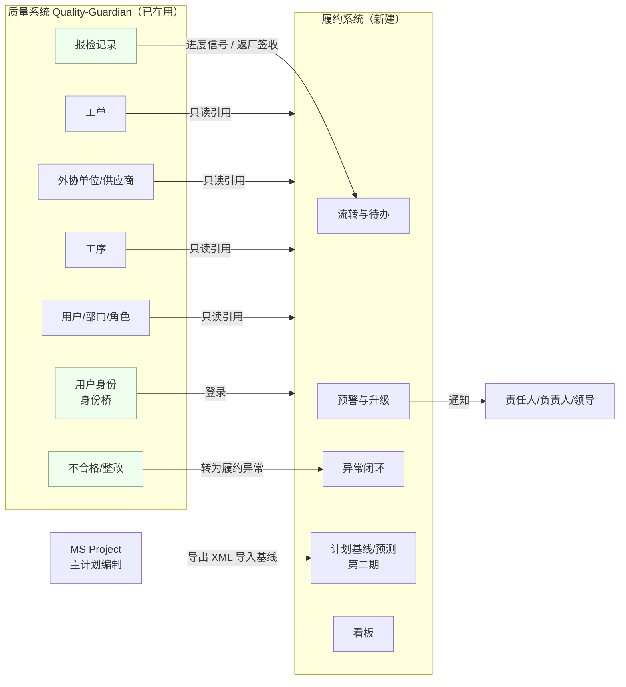
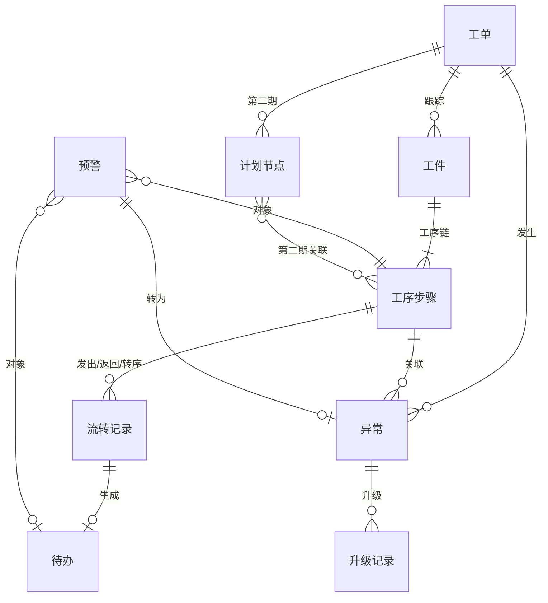
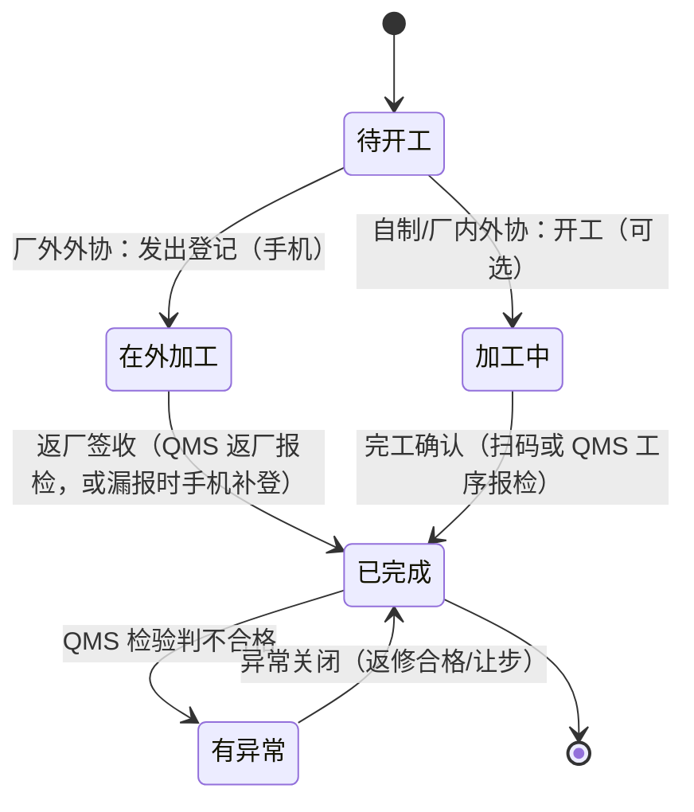
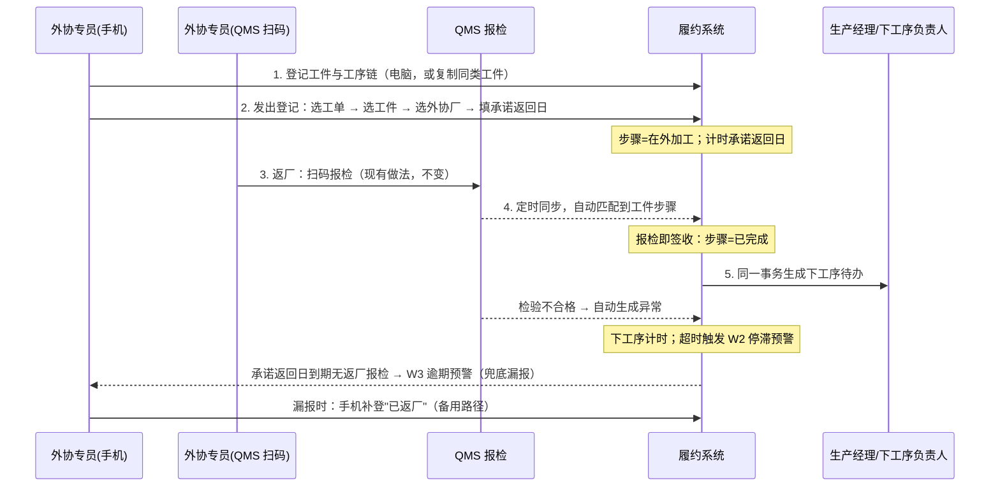
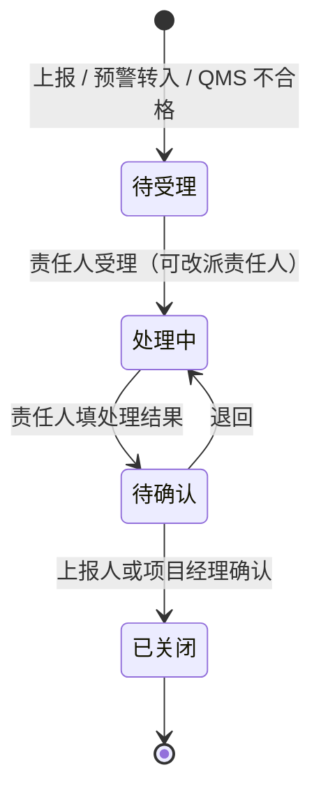

# 项目履约与异常管理系统：方案设计（v0.4）

> **版本**：v0.1（2026-10-16）→ **v0.2（2026-10-16，并入 zhao 三项确认：独立部署；微信小程序无法推送；返厂由外协负责人扫码报检）** → **v0.3（扫码报检的外协负责人即生产部外协专员，报检即签收）** → **v0.4（预警只做平台内提醒；推荐 QMS 接入方式与手机端方案，见 10.1、10.2）**
> **输入**：[现状流程与痛点.md](现状流程与痛点.md)（v0.4，下称"现状文档"），管控点编号 K01–K25、根因 R1–R6、交接点 H1–H12 均指该文。
> **用途**：全面方案，供 zhao 到各部门调研适用性；同时明确**第一期（MVP）范围**，作为第 3 步（技术选型与 MVP 范围）和第 4 步（搭建）的输入。
> **不含**：技术选型（框架、部署、是否作为 QMS 模块）。本文只写对选型的约束，见第 10 节。
>
> **标注说明**（沿用现状文档）
> - **【已确认】**：zhao 已回答，或代码核查确实存在。
> - **【推论】**：根据已确认事实推出的设计判断，需调研验证。
> - **【待调研】**：方案能成立，但参数或做法需各部门确认；对应问题汇总在第 12 节。

---

## 0. 一页摘要

1. **系统要解决的核心问题只有一个**：东西或信息到了，没人接、没人推下一步，也没人发现它停了（R1，Q12 返厂 7 天无人转涂装）。全部 25 个管控点里，K13 交接签收、K14 停滞预警、K20 外协跟踪、K16/K17 异常与升级是这一问题的直接解法，其余是扩展。
2. **一个通用机制覆盖所有交接**：系统的底层只有三样东西，**流转（谁把什么交给谁）→ 待办（接收方要做什么、何时前做）→ 规则（超时就预警、逐级升级）**。外协返厂、图纸发放、变更通知、到货、检验完成都是同一机制的不同"交接类型"，后续扩展只加类型，不加新流程。
3. **不重建已有的东西**：工单、外协单位、工序、用户、部门以 QMS 为准（只读引用）；QMS 报检记录作为进度信号；计划编制继续用 MS Project，履约系统只导入基线、叠加实际与预测（第二期）。
4. **第一期只做一条链路，用 1–2 个在制工单试点**：
   **外协发出登记 → 生产部外协专员在 QMS 扫码返厂报检（系统识别为返厂签收）→ 自动生成下工序待办 → 停滞/逾期预警 → 异常逐级升级 → 关闭**。
   返厂环节不给现场增加新动作，直接复用已有的 QMS 扫码报检，报检即签收【已确认，v0.3】。验收标准是"外协专员能用手机一步完成发出登记，Q12 那类停滞在 2 天内被系统发现"，不是文档或门禁通过。
6. **独立部署，平台内提醒**【已确认，v0.2/v0.4】：履约系统独立部署，经身份桥登录、经 QMS 新增的只读同步接口取数（推荐，见 10.1）；手机端是本系统的移动网页（推荐，见 10.2）；预警只在平台"我的提醒"里提示，不发短信。
5. **规则从简**：第一期只有 4 条预警规则、1 张阈值表、1 条升级阶梯，不做审批流、不做按项目自定义规则。新规则只在真实数据暴露问题后加。

---

## 1. 设计原则

| # | 原则 | 含义 | 来源 |
|---|---|---|---|
| P1 | **先可用，后治理** | 每一期都必须交付一线能用的功能；治理、审计、指标类机制在真实用户和数据出现问题后再加 | 【已确认】前几个系统"门禁和规则做得太细，跑不起来" |
| P2 | **一个机制，多种交接** | 所有交接统一为"流转 + 待办 + 规则"，不为每个部门单独设计流程 | 现状文档 2.5 举一反三 |
| P3 | **复用，不重建** | 主数据以 QMS 为准；计划编制以 MS Project 为准；系统只承载"履约视角"的状态与时间 | 现状文档 2.10、5.3 |
| P4 | **现场一步完成** | 手机端每个动作 ≤ 3 次点击，优先扫码；不能一步完成的动作不放给一线 | 现状文档第 6 节第 3 条；现场已接受扫码【已确认】 |
| P5 | **以时间为核心** | 每个对象都记三个时间：要求时间、承诺时间、实际时间。预警只依据时间判断，不依据主观填报的"进度百分比" | 【推论】零历史数据，主观进度不可信 |
| P6 | **漏报有兜底** | 任何依赖人主动上报的信号，都要有一个"到期未报"的反向检查（例如承诺返回日到期仍无返厂记录） | 【已确认】返厂报检有漏报 |
| P7 | **不做 ERP / PLM** | 采购、付款、图纸只做"发给谁、谁收了、哪天要、哪天到"，不做库存账、成本、图纸文件管理 | 现状文档 5.3 |

---

## 2. 系统边界与外部关系

| 外部 | 关系 | 方向 | 期次 |
|---|---|---|---|
| QMS 主数据（工单、外协单位、工序、用户、部门） | 履约系统**只读引用**，不复制维护、不回写；履约需要的扩展字段（如工单的项目经理、产品线）存在履约侧，按工单号关联 | QMS → 履约 | 一 |
| QMS 报检记录 | 外协返厂报检 = 返厂签收信号；工序报检 = 辅助完工信号（非强制，不能单独作为依据） | QMS → 履约 | 一（返厂）/ 二（工序） |
| QMS 不合格品 | 外协件返厂不合格自动生成履约异常，责任方为该外协单位 | QMS → 履约 | 一 |
| QMS 身份 | 沿用 QMS 用户体系登录（身份桥机制，对端由 GC 改为本系统）。履约系统**独立部署**【已确认，v0.2】，手机端是本系统自己的移动网页，不依赖 QMS 小程序；QMS 小程序继续只做报检 | QMS → 履约 | 一 |
| MS Project | 项目部继续用它编制和签字；履约系统导入已签字版本作为基线，**不回写** MS Project | MSP → 履约 | 二 |
| 微信群 | 不对接。系统上线后，微信群仍可用于沟通，但"东西到了""谁该接"以系统待办为准 | — | — |
| 财务/付款 | 只记录付款申请的状态和时间，不做审批、不做账 | 手工 | 三 |

**QMS 报检与履约对象的匹配【已确认 + 推论】**：代码核查（`apps/backend/prisma/schema.prisma` 中 `qms_inspection_requests`）显示，报检记录带 `workOrderNumber`（必填）、`partName`（必填）/`partId`（可选，来自项目 BOM）、`processName`/`processId`、`supplierId`、`quantity`、`submittedAt`、`inspectionResult`。现场扫码进入的是报检录入页，再选工单、物料、工序【已确认，代码】。因此：
- 识别返厂报检：报检记录的外协单位（`supplierId`，或责任类型为外协单位）非空，且该工单下存在"在外加工"中、外协单位相同的工件步骤。
- 匹配键优先用 **工单号 + 物料 ID + 外协单位**，物料 ID 为空时退化为 **工单号 + 物料名称 + 外协单位 + 工序名称**。
- 名称是自由文本时可能对不上【推论】，所以自动匹配失败的报检进入外协专员的"待确认匹配"列表，人工点一下关联，不阻断流程。
- 项目 BOM 在 QMS 中是否普遍维护【待调研】。如果普遍维护，履约系统的"工件"直接引用 QMS 的 BOM 物料。

---

## 3. 模块划分（全景）

| 模块 | 内容 | 覆盖管控点 | 期次 |
|---|---|---|---|
| **M1 工单与工件** | 引用 QMS 工单；登记需要跟踪的工件（外协结构件、关键件），维护工件的工序链 | K20 部分 | 一 |
| **M2 流转与待办（核心引擎）** | 统一的交接记录、签收、待办生成、拒收；所有其他模块通过它发起交接 | K13 | 一 |
| **M3 外协跟踪** | 外协发出登记、承诺返回日、返厂签收（取自 QMS 报检）、转下工序；厂内外协按自制班组处理 | K20 | 一 |
| **M4 异常闭环** | 手工上报、预警转异常、QMS 不合格转异常；受理、处理、确认关闭 | K16 | 一 |
| **M5 预警与升级** | 规则扫描、分级、去重、逐级升级、通知、每日汇总 | K14 K17 | 一 |
| **M6 看板** | 我的待办；外协在途表；项目红黄绿；未关闭异常 | K18 简版 | 一（简版） |
| M7 计划基线与预测 | 导入 MS Project 基线、节点实际、滚动预测、关键路径影响合同交期 | K03 K04 K05 K18 | 二 |
| M8 图纸与变更发放 | 图纸版本发放、变更通知发放，接收方签收，未签收预警 | K08 K09 | 二 |
| M9 车间工序进度 | 关键工序扫码确认、QMS 工序报检作为辅助信号、厂内外协队伍同样适用 | K15 | 二 |
| M10 销售进度视图 | 销售按工单看里程碑、在途外协、红黄状态，不再逐级询问 | K23 | 二 |
| M11 采购与付款跟踪 | 关键物料需求日/承诺日/到货；付款申请带交期影响，按影响排序；付款原因与管理原因分开 | K06 K10 K21 | 三 |
| M12 齐套与车间计划 | 按装配节点的缺件清单；车间周计划从主计划需求日派生 | K11 K12 | 三 |
| M13 设计出图任务 | 按部件拆分出图任务、客户确认作为独立节点、设计负荷 | K07 | 三 |
| M14 立项与交期差距 | 合同评审"评估交期 vs 合同交期"登记，差距超阈值提示提前启动；交底清单 | K01 K02 | 三 |
| M15 外协厂自报 | 外协厂（同时在制约 10 家）用手机报进度、承诺日变更 | K20 扩展 | 三 |
| M16 统计与复盘 | 按时率、异常分布、工序实际周期、多项目负荷、项目复盘 | K19 K24 K25 | 四 |

**25 个管控点全部有归属**：K01 K02→M14；K03 K04 K05 K18→M7；K06 K10 K21→M11；K07→M13；K08 K09→M8；K11 K12→M12；K13→M2；K14 K17→M5；K15→M9；K16→M4；K19 K24 K25→M16；K20→M3/M15；K22→第 2 节集成；K23→M10。

---

## 4. 核心数据对象

### 4.1 对象总览

### 4.2 第一期对象（字段只列必须的）

| 对象 | 关键字段 | 说明 |
|---|---|---|
| **工单** | 工单号（=QMS 主键）；履约扩展：项目经理、产品线、是否试点 | 基本信息、合同交期直接读 QMS `work_orders.deliveryDate`，不复制 |
| **工件**（跟踪单元） | 工单号、名称、图号、数量、引用 QMS 物料 ID（可空）、当前步骤、当前状态、**状态开始时间** | 只登记**需要跟踪的件**：走外协的结构件和关键件，不登记全 BOM【推论：一个架设设备工单约几十个，待调研】 |
| **工序步骤** | 工件、序号、工序（引 QMS `processes`）、执行方式（自制 / 厂内外协 / 厂外外协）、执行单位（班组或 QMS 外协单位）、要求完成日、承诺返回日（厂外外协）、实际开始、实际完成、状态 | 第一期不单独建"外协订单"，外协信息直接挂在步骤上（无价格、无合同），够用 |
| **流转记录** | 类型、关联步骤、发出方、接收方（人，或部门+角色）、发出时间、签收时间、签收人、数量、来源（手机扫码 / QMS 报检 / 电脑补录）、拒收原因 | **只增不改**的事件记录，是周期数据的来源（K25 的原始数据） |
| **待办** | 责任人、动作（签收 / 安排下工序 / 处理异常）、关联对象、到期时间、状态（待办 / 已完成 / 已转交）、完成时间 | 人看到的唯一清单。签收和"生成下一步待办"必须在一个事务内完成 |
| **异常** | 编号、工单、关联对象、分类、描述、照片、上报人、来源（手工 / 预警 / QMS 不合格）、责任部门、责任人、要求解决日、状态、当前升级级别 | 分类见 6.4 |
| **预警** | 规则编号、对象、级别、首次触发时间、当前级别、状态（活动 / 已消除 / 已转异常）、最近通知时间 | 同一对象同一规则只保留一条活动预警，级别上升时更新，不重复生成 |
| **升级记录 / 通知记录** | 对象、级别、通知对象、时间、渠道、是否送达 | 只用于追溯，不参与业务判断 |
| **阈值表** | 规则编号、提醒/黄/红天数、通知对象 | 管理员可改，全公司一套 |

### 4.3 工序步骤状态机（第一期核心）

**关键联动（Q12 的解法）**：步骤 N "已完成"的同一事务内，系统把步骤 N+1 的待办发给其负责人（下一道是厂外外协时发给外协专员"安排发出"，是自制时发给生产经理/班组长"安排开工"）。从这一刻起，步骤 N+1 处于"待开工"并开始计时，超过阈值未变为"在外加工/加工中"即触发 W2 停滞预警。

**分批返厂**【待调研】：第一期按数量记录，一个步骤可以有多次返厂流转，第一次返厂就生成下工序待办（结构件常常先回来先转），全部数量返回才算步骤完成。

### 4.4 后续期次对象（预留，第一期不建表）

| 对象 | 期次 | 要点 |
|---|---|---|
| 计划节点 | 二 | MS Project 任务 ID、名称、责任部门、基线开始/完成、实际、预测、前置依赖、基线版本号 |
| 基线版本 | 二 | 每次重新导入形成新版本，旧版本保留用于对比，不做审批流（由项目部在 MS Project 里签字） |
| 发放单（图纸 / 变更） | 二 | 版本号、发放对象列表；每个对象生成一条流转记录和签收待办（复用 M2） |
| 采购跟踪行 / 付款申请 | 三 | 需求日、承诺日、到货日；付款申请关联物料与计划节点，计算"晚一天影响交期几天" |
| 交期评审记录 | 三 | 评估交期、合同交期、差距、是否提前启动 |

---

## 5. 关键业务流程（第一期）

### 5.1 外协全链路

**返厂签收 = QMS 返厂报检**【已确认，v0.2/v0.3】：返厂时由生产部外协专员扫码报检，他们既知道东西到了，也负责推下一步，所以报检本身就是签收，现场不新增任何操作，也不需要仓库或门卫参与。履约系统定时（建议每 10–15 分钟）读取新增的返厂报检，按第 2 节的匹配键对到工件步骤，匹配成功即在同一事务内把步骤置为"已完成"并生成下工序待办；对不上的进入外协专员的"待确认匹配"列表，超时由 W1 预警。
- 检验结果后到：QMS 检验判不合格时，自动生成"外协-质量"异常，关联该步骤；合格不需要任何操作。
- 外协专员报检后、自己没有安排下工序，正是 Q12 的情形，由 W2 停滞预警升级到部门负责人和项目经理，不依赖外协专员自觉。

**漏报兜底**：返厂原则上必须报检但有漏报【已确认】。承诺返回日到期仍无返厂报检时 W3 预警外协专员；如果件其实已回来，外协专员在手机上补登"已返厂"，同时系统记一条"漏报检"，用于统计漏报率。

**流转卡**：v0.1 设想的随件二维码流转卡，第一期取消。返厂用 QMS 现有扫码，发出登记由外协专员在手机上按"工单 → 工件"选择，件数有限，不需要卡。

### 5.2 异常闭环

- 上报：手机上选工单（可再选工件）→ 选分类 → 一句话 + 照片 → 提交。系统按分类默认责任部门，责任人由部门负责人指派或默认值。
- 只有四个状态，不做会签、不做多级审批。
- 预警转异常：黄色预警由责任人点"转异常"，红色预警自动转异常。

---

## 6. 预警与升级规则

### 6.1 第一期规则（只有 4 条）

| 编号 | 规则 | 对象 | 提醒 | 黄 | 红 | 覆盖 |
|---|---|---|---|---|---|---|
| **W1** | 交接超时未签收 | 第一期：返厂报检未能自动匹配、外协专员未人工确认；第二期起：图纸、变更等待签收的流转 | 4 小时 | 1 天 | 3 天 | K13，H9 |
| **W2** | 转序停滞 | 上工序完成、下工序仍"待开工" | — | 2 天 | 4 天 | K14，Q12 |
| **W3** | 外协逾期未返 | 在外加工且超过承诺返回日 | 到期前 2 天 | 超期 1 天 | 超期 3 天，或要求完成日已过 | K20，兜底漏报 |
| **W4** | 异常超期 | 待受理超 1 天；或超过要求解决日 | — | 待受理 1 天 / 超期 1 天 | 超期 3 天 | K17 |

- 阈值均为**默认值【推论，待调研】**，在一张阈值表里由管理员修改，全公司一套，第一期不按项目、产品线定制。
- 计时第一期按**自然日**；国庆、春节等停工日由管理员在日历上标"停工日"，停工日不计时。（Q12 事故恰在 10 月 1 日返厂，说明节假日返厂正是高风险点【推论】，所以停工日只暂停计时，不屏蔽"到达"类提醒。）
- 预警自动消除：对象状态变化（已签收、已开工、已返厂、异常关闭）时，活动预警自动变为"已消除"，不需人工关闭。

### 6.2 升级阶梯

| 级别 | 通知对象 | 何时到达 |
|---|---|---|
| 提醒 | 责任人 | 规则"提醒"阈值 |
| 黄 | 责任人 + 责任部门负责人 + 该工单项目经理 | 规则"黄"阈值 |
| 红 | 以上 + 项目部负责人 + 分管领导 | 规则"红"阈值，自动转为异常 |

**举例（Q12 重演，按非停工日计）**：结构件第 1 天组焊返厂，外协专员当天在 QMS 扫码报检，系统同步后生成"安排涂装发出"待办。第 3 天仍未发出 → W2 黄，外协专员、生产部负责人、项目经理收到通知；第 5 天仍未发出 → W2 红，项目部负责人、分管领导收到，自动生成异常。现状是 7 天后客户催出来，方案下停滞满 2 天即被内部发现。若返厂时漏了报检，W3 在承诺返回日过后 1 天升黄。

### 6.3 通知与防疲劳

- **系统内待办是唯一权威入口**：所有预警都落在责任人的"我的待办/我的预警"里，手机打开即见。
- **只用平台内提醒，不推送**【已确认，v0.4】：不发短信、不用服务号。所有提醒、预警都进入系统的"我的提醒"，手机和电脑打开系统首页即见，带未读角标。
- **代价与对策**【推论】：没有推送时，提醒能否被看到取决于人是否打开系统。对策是让打开系统成为日常工作的一部分：①首页就是"我的提醒 + 我的待办"，不是菜单；②外协专员每天的发出登记、下工序安排都在系统里做，自然会看到；③电脑端保持登录时，新的黄、红预警在页面右上角弹出；④项目部负责人在例会上过一遍红色清单，作为领导层的固定查看点。
- **每日汇总**：每天早上在"我的提醒"顶部生成一条当日汇总（红黄数量 + 前 5 项），部门负责人、项目经理、领导打开即见。
- **防疲劳**：同一对象同一规则只发一次/级别；同一人同一小时内多条合并为一条；领导只收红色和每日汇总。

### 6.4 异常分类（第一期）

| 分类 | 默认责任部门 | 说明 |
|---|---|---|
| 设计（图纸缺、错、晚） | 技术部 | |
| 变更 | 技术部 | 第二期 M8 上线后大部分由签收机制覆盖 |
| 物料-付款原因 | 财务 / 采购 | **必须与管理原因分开**（现状文档 A4/A5、K21） |
| 物料-管理原因 | 采购 | |
| 外协-进度 | 生产部（外协专员） | 责任方可选具体外协单位 |
| 外协-质量 | 质量部 | QMS 不合格自动转入 |
| 车间 | 生产部 | |
| 客户（等确认、改需求） | 项目部 / 销售 | 记录客户原因，延期责任可界定（N8） |
| 其他 | 项目部 | |

---

## 7. 角色与操作

### 7.1 各角色在手机和电脑上做什么

| 角色 | 手机（现场，扫码为主） | 电脑 | 第一期是否参与 |
|---|---|---|---|
| **外协专员**（生产部） | 发出登记、返厂时在 QMS 扫码报检（现有动作，即签收）、处理"安排下工序"待办、改承诺返回日、漏报时补登返厂、看外协在途 | 登记工件和工序链、处理"待确认匹配"的报检 | **是，核心用户** |
| **质检员** | 不新增操作，继续在 QMS 报检/检验 | — | 间接（QMS 数据） |
| **生产经理 / 班组长** | 处理"安排开工"待办、上报异常、看本车间预警 | 看车间在制与停滞列表 | **是** |
| **项目经理**（项目部） | 收黄/红预警、确认异常关闭 | 看所负责工单的外协在途、异常、红黄状态；维护工单扩展信息 | **是** |
| **部门负责人** | 收黄/红预警、指派异常责任人 | 看本部门待办和异常 | **是** |
| **管理层 / 分管领导** | 收红色预警和每日汇总 | 全部工单红黄绿看板 | **是**（只看） |
| 设计师 / 设计主管 | 签收变更回执（第二期，主要是接收方签收） | 发放图纸/变更、维护出图任务 | 二、三期 |
| 采购 | 到货登记 | 采购跟踪、付款申请 | 三期 |
| 财务 | — | 按交期影响排序的付款清单 | 三期 |
| 销售 | 查看工单进度 | 查看工单进度 | 二期 |
| 外协厂 | 报进度、改承诺日 | — | 三期 |
| 管理员 | — | 维护阈值表、停工日、账号角色 | 是 |

### 7.2 一线操作步数（第一期验收用）

| 动作 | 步骤 | 目标 |
|---|---|---|
| 外协发出 | 选工单 → 选工件 → 选外协厂（默认上次）→ 选承诺返回日 → 提交 | ≤ 4 次点击 |
| 返厂签收 | 外协专员在 QMS 扫码报检（现有动作，履约不新增） | 0 次新增 |
| 安排下工序 | 打开待办 → 选外协厂和承诺返回日（即下一道的发出登记）/ 或转给生产经理 | ≤ 3 次点击 |
| 上报异常 | 选工单 → 选分类 → 一句话 + 照片 → 提交 | ≤ 1 分钟 |

### 7.3 数据权限（第一期从简）

只按"角色 + 部门 + 负责工单"三个维度：
- 一线和外协专员：看所有试点工单的跟踪工件（人少、工单少，第一期不细分）。
- 项目经理：看自己负责的工单；部门负责人：看本部门的待办与异常；领导：看全部。
- 权限判断放在服务层统一处理，不在每个页面各写一套【约束，见第 10 节】。
- 第一期**不做**字段级权限、不做数据脱敏规则。

---

## 8. 分期路线

分期以**上一期在真实工单上用起来**为进入下一期的条件，不以日期为准。

### 第一期（MVP）：外协交接闭环

| 项 | 内容 |
|---|---|
| 模块 | M1 工单与工件、M2 流转与待办、M3 外协跟踪、M4 异常闭环、M5 预警与升级（W1–W4）、M6 简版看板 |
| 集成 | QMS 主数据只读、QMS 返厂报检匹配、QMS 不合格转异常、QMS 身份登录 |
| 试点 | 1–2 个在制且有外协结构件的工单【待调研：选哪个】 |
| 用户 | 外协专员、生产经理、项目经理、部门负责人、领导，约 10–20 人【推论】 |
| **明确不做** | MS Project 导入、图纸/变更发放、车间全工序报工、采购付款、齐套、设计任务、外协厂自报、统计报表、审批流、按项目定制规则、字段级权限 |
| 验收（全部满足才算完成） | ① 试点工单所有外协件有发出和返厂记录；② 外协专员用手机完成 7.2 的动作，无需培训手册；③ 人为制造一次"返厂后不转序"，系统在阈值内发出黄、红预警并升级到领导；④ 试点期内 QMS 返厂报检的自动匹配率可统计，且每一条返厂报检都能在 15 分钟内自动完成签收并生成下工序待办，或出现在"待确认匹配"列表里；⑤ 试点用户每个工作日至少打开一次"我的提醒"（系统可统计）；⑥ 试点期内项目经理不再需要在微信群里问"外协件回来没有" |
| 观察指标 | 转序停滞次数与平均时长、W3 逾期次数（反映外协厂承诺可靠性）、漏报检被 W3 发现的次数 |

### 第二期：计划可见、变更可达

| 模块 | 价值 |
|---|---|
| M7 计划基线与预测（导入 MS Project） | 计划从"签字后不更新"变成"实际与预测可见"，节点延误传导到合同交期 |
| M8 图纸与变更发放签收 | 解决"变更漏到车间"（R1 同一机制扩展） |
| M9 车间关键工序扫码 + QMS 工序报检信号 | 自制和厂内外协也进入停滞监控 |
| M10 销售进度视图 | 客户问进度不再逐级询问 |

进入条件：第一期验收通过，试点扩大到全部在制工单（约 10 个），外协专员持续使用 2–4 周。

### 第三期：上游前移

M11 采购与付款跟踪（含付款按交期影响排序）、M12 齐套与车间周计划、M13 设计出图任务、M14 交期差距登记与提前启动、M15 外协厂自报。

### 第四期：数据与考核

M16 统计与复盘：按时率、异常分布、各类工序实际周期（来自第一期起积累的流转记录）、多项目负荷、项目复盘。此时才讨论把数据用于部门考核（K25）。

---

## 9. 与管理制度的关系

- 现有管理制度【已确认存在，内容待调研】中的考核与升级条款，在第一期只映射**升级阶梯和时限**（6.2），不映射考核。
- 制度未覆盖、但方案新增的规则：交接签收时限（W1）、转序停滞时限（W2）。这两条需要管理层确认后写入制度，否则预警没有约束力【推论】。
- 数据用于考核放在第四期。过早考核会让一线倾向于不登记或补录假时间，破坏周期数据【推论】。

---

## 10. 对技术选型（第 3 步）的约束

以下是方案对第 3 步的硬性要求，选什么技术由第 3 步决定。

| # | 约束 | 原因 |
|---|---|---|
| T1 | 必须能读取 QMS 的工单、外协单位、工序、用户、部门、报检、不合格数据，且**不改写 QMS 主数据** | P3；避免两套主数据 |
| T2 | **独立部署**【已确认，v0.2】：独立数据库和服务；经身份桥登录，经 QMS 只读同步接口取数（见 10.1）。不得让 QMS 依赖履约系统才能正常运行 | 首要架构决策已定 |
| T3 | 手机端为本系统自己的移动网页（见 10.2），支持拍照，复用 QMS 用户登录；第一期不需要扫码（返厂扫码在 QMS） | N1；独立部署 |
| T4 | 必须有可靠的定时扫描能力（规则每 15–60 分钟扫描一次即可，不需要实时流处理） | 预警以天计 |
| T5 | 提醒只在平台内："我的提醒"首页、未读角标、电脑端弹出；不接短信、服务号、小程序推送 | 6.3【已确认，v0.4】 |
| T6 | "返厂报检同步 → 步骤完成 + 生成下一步待办 + 消除预警"必须在一个事务内完成；QMS 报检同步必须幂等（同一报检记录重复同步不产生两次签收） | 数据一致性 |
| T7 | 数据权限在服务层统一判断，路由/接口层保持轻量 | 7.3 |
| T8 | 工程门禁限于：类型检查、核心路径测试（流转状态机、规则判定、QMS 匹配）、代码评审。指标治理、文档同步检查、多层审批类机制第一期不建 | P1；记忆中的教训 |
| T9 | 流转记录只增不改，保留原始时间，便于第四期统计 | P5 |
| T10 | 第一期规模：约 10 个工单、几百个跟踪工件、20 名用户。不为大规模并发做设计 | 防止过度设计 |

### 10.1 QMS 数据接入方式（推荐）

**推荐：QMS 新增一组只读同步接口，履约系统定时增量拉取，存一份本地只读副本。**

| 方案 | 做法 | 结论 |
|---|---|---|
| A 直连 QMS 数据库（只读账号） | 履约系统直接查 QMS 的 MySQL 表 | **不推荐**：QMS 表结构改动频繁【已确认：变更日志约 700KB】，任何改表都可能让履约悄悄坏掉；还要自己重复处理软删除、归档等 QMS 内部规则；跨系统共享数据库账号，边界不清 |
| **B QMS 只读同步接口 + 定时增量拉取** | QMS 提供几个只读接口，按"上次同步时间"返回新增和变更的数据；履约每 5–10 分钟拉一次，写入自己库里的只读副本 | **推荐**：接口就是两个系统之间的约定，QMS 内部怎么改表都不影响履约；QMS 停机时履约照常可用，恢复后补拉 |
| C QMS 主动推送（webhook） | QMS 每次报检时调用履约 | 不推荐第一期：QMS 要处理推送失败重试，反而让 QMS 依赖履约；预警以天计，5–10 分钟的拉取足够 |

**方案 B 的具体内容**

- 接口清单（第一期 6 个，全部只读）：工单、外协单位、工序、用户与部门、报检记录、不合格品。每个接口都接受 `since`（上次同步时间）和分页，按 `updatedAt` 返回，含已删除标记。
- 认证：复用身份桥已有的客户端 ID + 密钥（`X-Identity-Client-Id` / `X-Identity-Client-Secret`）【已确认：代码中已有此客户端认证】，不再新造一套。
- 履约侧：同步任务记录每类数据的游标；同一条报检按 QMS 主键幂等写入，重复拉取不会产生两次签收（对应 T6）。
- 登录：身份桥只返回用户 `{id, name, active}`【已确认，`identity-bridge/ARCHITECTURE.md`】，部门和角色从同步来的用户数据里取。
- 工作量：QMS 侧是 6 个只读查询接口，不改任何现有表；不要为它加治理、审计、限流之外的机制（P1）。
- **部署位置**【已确认：QMS 在云服务器】：推荐履约系统部署在**同一台云服务器（或同一云厂商同一内网）**。履约调用 QMS 接口走内网地址，不经公网；数据库可用同一个 MySQL 实例里的**独立数据库和独立账号**，履约账号无权访问 QMS 库，QMS 账号也无权访问履约库，这样既省一台服务器，又保持独立部署的边界。服务器资源不够时再拆到第二台，接口方式不变。
- **域名**：给履约分配一个独立子域名并配置 HTTPS 证书（身份桥回调必须是 HTTPS），手机在厂内厂外都能用流量直接访问。

### 10.2 手机端方案（推荐）

**推荐：履约系统自己的移动网页（响应式 Web），与电脑端同一套程序，不做小程序、不做 App。**

| 方案 | 结论 |
|---|---|
| **移动网页（推荐）** | 一套代码同时服务电脑和手机；发链接或二维码即可打开，可在微信里打开，也可"添加到主屏幕"；发版即生效，不用审核；平台内提醒不需要推送能力，网页完全够用 |
| 新建一个微信小程序 | 独立部署后需要新的小程序账号、单独开发和审核发布；推送能力已确认无法使用，小程序的主要优势用不上 |
| 原生 App | 一线安装意愿低，开发成本最高，不考虑 |

- 手机端第一期只做 4 个页面：我的提醒/待办（首页）、外协在途、发出登记、上报异常。电脑端在此基础上增加工件与工序链维护、待确认匹配、看板、阈值和停工日设置。
- 登录：手机上打开履约系统 → 跳转到 QMS 登录 → 身份桥回调到履约。身份桥要求 HTTPS 回调地址【已确认，`config.ts`】，所以履约系统需要一个 HTTPS 域名或内网证书。微信内置浏览器里走这套跳转是否顺畅，第 4 步实测。
- 登录保持：手机端登录状态保持较长时间（如 30 天），避免一线每次打开都要重新登录，否则"打开系统"这件事本身就会劝退用户。

---

## 11. 风险与对策

| 风险 | 可能性 | 对策 |
|---|---|---|
| 一线不扫码、不签收（系统变成又一个没人用的表） | 中高 | 第一期只给一线 2 个动作；外协专员是核心用户，先确保他/她的工作量下降（在途表替代电话和微信群）；W3 兜底漏报 |
| QMS 物料名称与履约工件对不上 | 中 | 优先用 QMS BOM 物料 ID；对不上的进人工匹配列表，不阻断 |
| 预警没人看到（无推送，依赖打开系统） | 中高 | 6.3 的四项对策；验收第⑤条统计打开率；试点后如打开率低，再讨论加推送渠道 |
| QMS 返厂漏报检，返厂信号缺失 | 中 | W3 承诺返回日兜底；外协专员手机补登；统计漏报率，必要时由管理层把返厂报检写入考核 |
| QMS 同步中断，返厂长时间未进入履约 | 低 | 同步失败在管理员"我的提醒"里置顶并在看板显示最后同步时间；按游标补拉，不丢数据 |
| 预警太多，被当作噪音 | 中 | 只有 4 条规则；去重合并；领导只收红色；阈值可调 |
| 重蹈覆辙：先做规则、权限、治理，功能不交付 | 高（历史已发生 2 次以上） | 第 8 节"明确不做"清单；验收以一线用起来为准；新规则需要有真实数据问题作为理由 |
| 节假日、停工期误报 | 低 | 停工日日历 |

---

## 12. 调研验证点（补充到部门调研提纲）

以下问题决定本方案的参数和做法，建议 zhao 调研时一并确认。

| 部门 | 问题 | 影响 |
|---|---|---|
| 外协（生产部外协专员） | 一个工单大约有多少个走外协的结构件？每件通常几道外协？ | 跟踪工件数量 |
| 外协/质量 | 返厂报检时，选的物料是 QMS 项目 BOM 里的物料，还是手填名称？ | 自动匹配率 |
| 外协 | 外协厂给的承诺返回日可靠吗？能当场问到吗？ | W3 的可用性 |
| 外协 | 分批返厂多不多？回来一部分能否先转下道？ | 4.3 分批 |
| 生产 | 返厂后"安排下工序"是外协专员还是生产经理负责？ | 下工序待办发给谁 |
| 生产/项目部 | W1–W4 的默认阈值（4 小时/1 天/2 天/3 天）是否合适？ | 阈值表 |
| 项目部/管理层 | 黄、红分别通知到谁？领导是否每天打开系统看红色清单，还是只在例会上看？ | 6.2、6.3 |
| 质量 | QMS 项目 BOM 是否每个工单都维护？外协返厂报检时选的是 BOM 物料吗？ | QMS 匹配方式 |
| 管理层 | W1、W2 两条新时限能否写入管理制度？ | 第 9 节 |
| 管理层 | 第一期试点选哪 1–2 个工单？ | 第 8 节 |

---

## 13. 下一步

1. zhao 拿本方案和 [部门调研提纲.md](部门调研提纲.md)（加上第 12 节）去各部门调研，重点是外协专员和生产部。
2. 第 3 步线程：基于第 10 节约束做技术选型（独立部署、QMS 只读同步接口、移动网页、平台内提醒均已定；第 3 步选具体框架和部署环境），并按第 8 节锁定第一期范围和验收标准。
3. 调研结果回来后更新本方案为 v0.2（阈值、角色分工、试点工单）。

*v0.4 · 2026-10-16*
